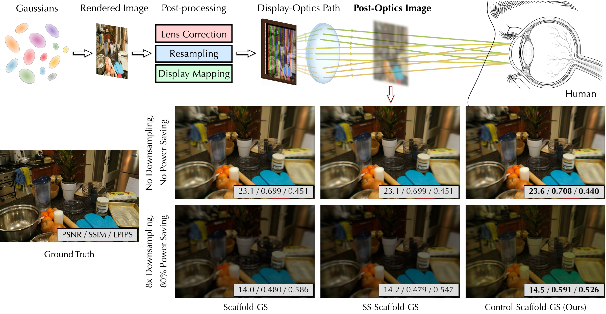

# 🎛️ [SIGGRAPH Asia 2026] ControlGS: Conditioning Neural Gaussians for Downstream-Processing-Aware XR Rendering

Train and render resolution, display-power and lens plugins on frozen Scaffold-GS models. Released scenes: **stump** and **materials**.



<h3 align="center">
  <a href="https://horizon-lab.org/controlgs/">🌐 Project Page</a> ·
  <a href="https://arxiv.org/abs/2609.32038">📄 Paper</a> ·
  <a href="https://github.com/horizon-research/ControlGS">💻 Code</a> ·
  <a href="https://drive.google.com/drive/folders/1WSmc7E38Da3KMjVs7HL9kuu_Jzrhp8kC">🧠 Models</a>
</h3>

## ⚙️ Install

Linux, NVIDIA GPU, Python 3.11 and CUDA 13.0. Tested on RTX 5090 with PyTorch 2.11.0.

```bash
git clone https://github.com/horizon-research/ControlGS.git
cd ControlGS
CUDA_HOME=/usr/local/cuda-13.0 TORCH_CUDA_ARCH_LIST=12.0 bash scripts/setup.sh
```

Setup clones [Scaffold-GS](https://github.com/city-super/Scaffold-GS) at `59c833b`, applies our two patches, and builds the CUDA extensions. Only the patches are tracked here. To fetch and patch Scaffold separately: `bash scripts/fetch_scaffold.sh`.

## 📂 Scene data

Download [Mip-NeRF 360](https://jonbarron.info/mipnerf360/) and [NeRF Synthetic](https://github.com/bmild/nerf), then prepare:

```text
dataset/
├── mip360/stump/             # images_4/ and sparse/ COLMAP files
└── nerf_synthetic/materials/ # transforms_*.json and RGB images
```

Use `--data-root /path/to/datasets` for another location. Scene images and cameras are required; weights and PSF download automatically from [Google Drive](https://drive.google.com/drive/folders/1WSmc7E38Da3KMjVs7HL9kuu_Jzrhp8kC), with SHA-256 verification.

## 🔬 Optics and Zemax

Training and inference use the released precomputed PSF, downloaded automatically. [Google Cardboard Zemax files](tools/zemax/) are included in this repository: the RGB lens design (`.ZMX`, `.zar`, `.ZDA`), PSF extraction script and configuration. To regenerate PSFs on Windows with Zemax OpticStudio, follow the [lens instructions](tools/zemax/LENS_ASSET_README.txt).

## ▶️ Inference

```bash
./inference/run_demo.sh --scene materials --smoke
./inference/run_demo.sh --scene stump --smoke
```

`--smoke` renders one view. For a condition grid, replace it with `--max-views 1 --savings 0,0.4 --downscales 1,2`. PNGs are saved under `outputs/`. Add `--checkpoint outputs/materials-plugin` to render your trained plugin, or `--evaluate` for metrics.

## 🏋️ Training

```bash
./training/train.sh --scene materials --stage distort --output-dir outputs/materials-distort
./training/train.sh --scene materials --stage plugin \
  --distort-checkpoint outputs/materials-distort/distort_mlp.pth \
  --output-dir outputs/materials-plugin
```

Use `--scene stump` for stump. Both stages run 10,000 iterations, with PSF optics in the last 1,000. Omit `--distort-checkpoint` to use the supplied baseline. Add `--smoke` for a two-iteration plugin check using the supplied baseline. Choose a fresh output directory for each run.

## 🙏 Credits

[Scaffold-GS](https://github.com/city-super/Scaffold-GS) and its dependencies retain their upstream licenses; see [third-party notices](THIRD_PARTY_NOTICES.md).
